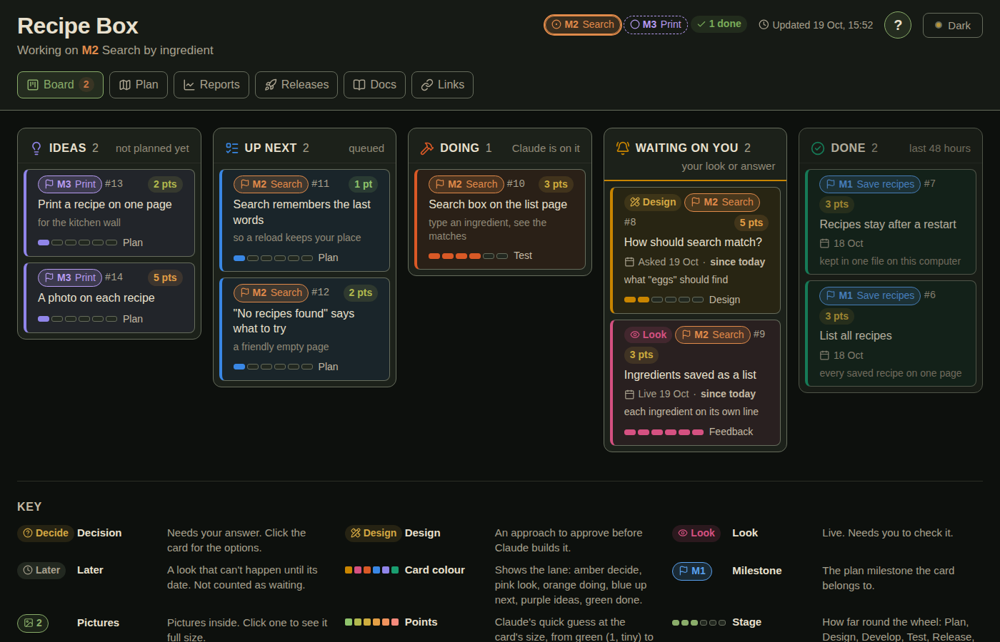
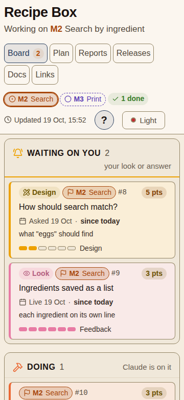
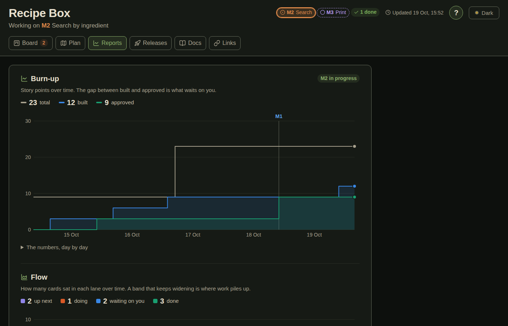

# soloagile

Agile for one person and Claude. A [Claude Code](https://claude.com/claude-code) plugin
that gives every project a private page, and keeps it current as the work happens.



The page shows six things: the **board**, the **plan**, **reports**, the **release notes**,
brief **docs**, and **links** to everything Claude creates. You read it; Claude writes it.
To change anything, you tell Claude.

## Install

In Claude Code:

```
/plugin marketplace add richardkoi/soloagile
/plugin install soloagile@soloagile
```

It needs **Node 22 or newer** and **git**. It is for Claude Code on a computer, in the
terminal, the desktop app or an editor.

So far it has been tried on Linux only, with Chrome, Chromium and Brave. A Mac, Windows,
Firefox and Safari are untried.

It has one option: commit and push the board when a session ends. It is off unless you
turn it on, in `/config`.

## Start

Open Claude in a project's folder and type:

```
/soloagile:init
```

Claude gives the project a `pm/` folder and builds its page. A project that already has
notes or a to-do list gets its board built from those. Claude prints the page's link:
open it in a browser and leave it open. It refreshes itself as cards move.

## What you say

| You say | What happens |
|---|---|
| "catch me up" | Where you left off, what moved, what waits on you and what's next |
| "what needs me" | Every waiting card as a multiple-choice question |
| "commit" | Claude reads the changes, runs the checks, then commits and pushes |
| "done for today" | Claude tidies the board and writes a note for next time |
| "retro" | At a milestone's end: what worked, what to change, what's next |

Each one is also a command, such as `/soloagile:catchup`.

## How the work goes

Every card goes round six stages, and a bar on the card shows how far round it is:

**Plan → Design → Develop → Test → Release → Feedback**

- A card of 3 points or more waits for your yes on its design before any code.
- A card reaches you already tested, with a line saying what was checked.
- Only your yes moves a card to Done.

The lane called **Waiting on you** holds what needs your answer or your look, so you
can tell at a glance whether Claude is waiting for you.



The Reports tab charts the project from the board's own history: points built and
approved, cards in each lane over time, and how long cards of each size took.



## Where things are

- **In each project:** `pm/`, a few small Markdown files and the page built from them,
  `pm/index.html`. The Markdown is committed; the page is not.
- **On your computer:** `~/.soloagile/`, which holds a home page listing every project
  in the same folder, and an optional `settings.json`.
- **No server.** A page opens as a file. To read your pages from a phone, there is a
  small optional server in [`extras/page-server`](extras/page-server).

The format of every file, and each rule Claude follows, is in [SPEC.md](SPEC.md).

## Screenshots

At the Test stage Claude takes four screenshots of anything seen in a browser: desktop
and phone width, dark and light. That needs Chrome, Chromium, Edge or Brave on the
computer. Without one, everything else still works.

## Licence

MIT. Icons are from [Lucide](https://lucide.dev) (ISC), and Markdown is rendered by
[marked](https://marked.js.org) (MIT); both licences are in `vendor/`.
