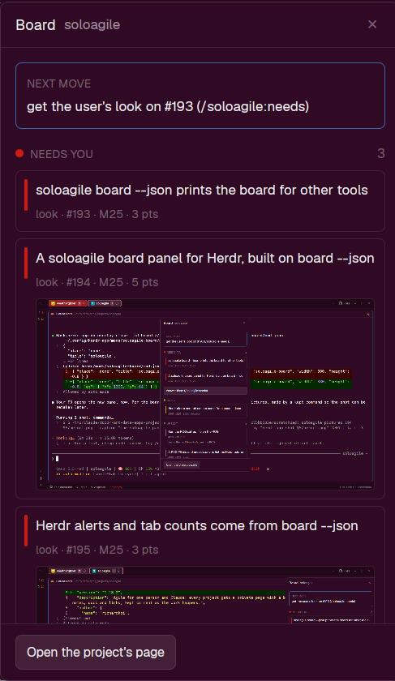

# soloagile board

A floating window, opened with F3, that shows the soloagile board of the project in the
focused terminal: the next move, the cards waiting on you, Doing, the top of Up next and
the milestones being worked on, with each card's pictures and links. A second, hidden
mod alerts you when a card starts waiting on you, and shares how many wait in each space.

## What you see

**soloagile-board**, a window 380px wide and 80% of the window's height, first placed at
x 1366, y 64 (it remembers where it is dropped; key `soloagile-board`). Theme colours
only, 13px text, `surface` background.

1. **Title bar**, 14px padding, a `border` line under it: "Board" (14px, semibold,
   `foreground`), the project's name (`muted`, truncated), and a ✕ (`dim`, `foreground`
   on hover).
2. **Next move**, a box with a 1px `accent` border on `background`, 6px corners: "NEXT
   MOVE" (11px, semibold, `dim`) over the sentence soloagile gives, such as "get the
   user's look on #193 (/soloagile:needs)".
3. **Needs you**: an 8px `blocked` dot, "NEEDS YOU" (11px, semibold, `dim`) and the count
   on the right. Then the decision and look cards, and a button "Answer them
   (/soloagile:needs)" (`raised`, 1px `border`, 12px, 6px corners) when any wait.
4. **Doing**, the same with a `working` dot.
5. **Up next**, the same with an `idle` dot: the first 5 cards, the count reading "5 of 9"
   when there are more.
6. **Milestones in progress**, under a `border` line: each milestone with a card waiting,
   in Doing or in Up next: "M25 Herdr add-on" and "2/5", over a 6px bar (`raised`, filled
   `done` to that share).
7. **Footer**, a `border` line above: a button "Open the project's page".

A **card** is a `background` box, 1px `border`, 6px corners, 8px padding, `hover` on
hover: a 3px × 30px stripe in its section's colour, then the title (`foreground`,
wrapping), a line of tags (11px, `dim`: "look · #194 · M25 · 5 pts"; a Doing card adds its
stage; "3 pictures" when it has more than one), "waits: …" (11px, `muted`) on an Up next
card held back, and its first picture, as wide as the card, never taller than wide, 4px
corners, 1px `border`.

Empty states: "Nothing waiting on you.", "Nothing in Doing.", "Nothing in Up next."; with
no project, "Click into a terminal to show its project's board."; then "Reading the
board…", "No board in this project.", "soloagile isn't installed on this machine." or
"This soloagile is too old for the panel: update it to 1.18.0 or later."

**soloagile-alerts** is a 1px strip at the bottom of the layout in the `canvas` colour.

## How it behaves

- The panel follows focus: every second it checks the focused terminal's folder, finds its
  git repo (`git rev-parse --show-toplevel`) and shows that project's board.
- It reads the board again when anything in the project's `pm/` folder changes, and every
  10 seconds, since Linux skips git-ignored folders when watching.
- A click on a card opens it: all its pictures (each labelled "option a" when it is a
  design option's), its note lines (12px, `muted`; "No notes on this card." when none),
  then "Its page of pictures" and each address in its notes as underlined `accent` links.
  Another click closes it.
- A click on a picture opens it full size, and a click on a link opens it, with
  `xdg-open`. "Open the project's page" opens the board's page the same way.
- "Answer them (/soloagile:needs)" types `/soloagile:needs` into the Claude in the same
  space (`hc send`) and focuses it; with no Claude there, it opens a new tab running
  `claude /soloagile:needs` in the project's folder.
- A look dated "from" a later day isn't waiting yet, so it isn't shown or counted.
- The alerts mod reads the board of every space on this computer every 15 seconds. A card
  new to Needs your look or Needs your decision posts a pop-up "<project> needs you" /
  "#<n> <title>" (level warning; a click shows that space), plays the `blocked` sound once
  per round, and sends `notify-send` while Herdr isn't the window in use. A project seen
  for the first time is only remembered, so a restart replays nothing; a card that leaves
  and comes back alerts again. It sets `shared("soloagile.waiting")` to
  `{ [space id]: count }` for a tab bar to show.

## Built from

- `mods/soloagile-board/` (`mod.json`: place `none`, overlay window, key
  `soloagile-board`) and `mods/soloagile-alerts/` (`mod.json`: place `bottom`, size 1).
  `keys.json`: `"f3": "mod.open:soloagile-board"`.
- Data: `soloagile board --json <project>` (soloagile 1.18.0 or later; pictures and links
  from 1.18.2). Its shape is in soloagile's SPEC.md: `project`, `page`, `counts`, `next`,
  `lanes` (each card with `pictures`, `picturePage`, `links`, `waits`, `later`) and
  `milestones`. Neither mod reads the Markdown.
- The command is found with `command -v soloagile`, else the newest
  `~/.claude/plugins/cache/soloagile/soloagile/*/bin/soloagile`.
- `herdr`: `focused`, `spaces`, `panes`, `agents`, `exec`, `run` (`pane.focus`, `tab.new`,
  `space.select` in a pop-up), `watchFolder`, `notify`,
  `playSound`, `shared`/`setShared`, `window`, `settings`, `appHome`, `theme`, `props`,
  `closeOverlay`; `gpui-kit`'s `image`.
- Programs: `soloagile`, `git`, `sh`, `cp`, `sed`, `xdg-open`, `notify-send`, `hc`.

## Watch out

- `soloagile` is on the PATH only inside Claude Code sessions; look in the plugin cache.
- Leaving a Node program with `process.exit` right after a big write into Herdr's
  non-blocking pipe cuts it off at 64 KB. soloagile 1.18.1 waits for the write; older ones
  give a big board's JSON cut short, and the mods see no board.
- `image()` reads only from Herdr's own folder: a full path or a `../` path shows an empty
  box. Copy each picture into `data/soloagile-board/pictures/` (`cp -u`, named after its
  path with `/` as `_`) and show that.
- `on_size_change` reports screen pixels; layout sizes are before zoom. Divide by
  `settings().zoom` before sizing a picture, or it runs past the card.
- Pictures and the page button work on this computer only; a space on another machine
  shows the board without pictures and without watching `pm/`.

## Done when

1. `herdr-app check` passes on both mod folders.
2. F3 in a soloagile project's terminal shows its next move, the waiting cards, Doing and
   Up next as `soloagile next` lists them, with the milestone bars.
3. A card with a picture page (`soloagile pictures <n> …`) shows its first picture inside
   the card, at the card's width.
4. Moving a card to Needs your look posts the pop-up within 15 seconds, and that space's
   count in `shared("soloagile.waiting")` goes up by one.
5. A project of 75 KB of JSON (hundreds of cards) still shows its board.
